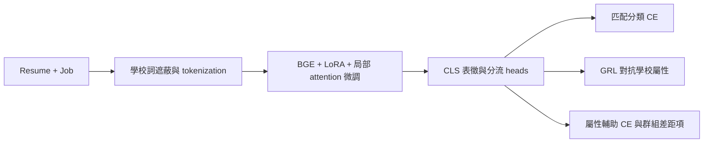

# BGE LoRA Fairness Fine-Tuning

英文履歷–職缺匹配的公平性研究原型，探索如何把學校背景相關的群組差距，納入模型訓練、檢查點選擇與離線評估。

專案以 `BAAI/bge-large-en-v1.5` 為基底，實作 LoRA、局部 backbone 微調、對抗去偏、多任務學習、學校詞遮蔽及評估分析流程。作品集重點是公平目標的建模與可檢查的實驗設計；目前評估權重載入和結果 provenance 仍需補齊，尚不能宣稱公平微調已造成效能或公平性的改善。

## 研究問題

履歷–職缺匹配不只需要辨識技能與工作需求，也需要檢查模型是否依賴學校聲望等背景訊號。本專案探索：

1. 能否透過表徵學習與文字遮蔽，降低學校背景資訊對匹配分數的影響？
2. 如何同時觀察匹配效用、群組選取率差距與反事實分數變化？
3. 如何讓模型選擇與推論結果具有可追溯的條件，而非只報告單一公平分數？

## 專案實作範圍

- **模型與訓練**：BGE encoder、LoRA 與部分 attention 權重調整，加入匹配分類、對抗判別及學校屬性輔助 heads。
- **資料處理**：學校背景特徵、文字遮蔽、加權抽樣與平衡驗證集。
- **評估分析**：分類效用、群組選取率、反事實擾動、曝光分析及質性解釋。
- **實驗管理**：溫度校正、門檻搜尋、不同目標的 checkpoint 儲存與 adapter 匯出程式。

上述為 repository 可檢查的實作內容；部署、實際採用及真實招募成效尚未驗證。

## 模型與訓練設計



[FairLoRAModel][model] 以 CLS embedding 加上投影與多個 heads 建立分類路徑。[FairTrainer][trainer] 包含對抗判別器更新、gradient reversal、輔助分類與公平目標，以及驗證門檻／checkpoint 選擇。

| 項目 | 快照中的實作 |
|---|---|
| Backbone | `BAAI/bge-large-en-v1.5` |
| LoRA | 模型 constructor 使用 `r=16`、`alpha=32`，動態探索包含 query／key／value／dense 的目標層 |
| 可訓練 backbone | 除 LoRA 外，最後四層的部分 attention base weights 也可訓練 |
| 訓練輸入 | 遮蔽後履歷與職缺串接，經 CLS 表徵及分類 head |
| Notebook 設定 | batch size 8、max sequence length 256、資料載入 seed 42；最多 15 epochs，另有早停 |
| 敏感屬性 | 訓練路徑使用 top_school／non_top_school／no_school_mentioned |

`fair_lora_config.py` 的 r=8／alpha=16 與模型 constructor 不一致，因此以上列出 source 的有效設定，不把 config 值當成已完成實驗的設定。這個路徑也不屬於「只更新 LoRA adapters、完全凍結 backbone」的微調。

公平目標仍有實作限制：DP proxy 使用群組平均正類機率的變異數；EO 項使用硬 `argmax`，額外 gap 項在 `no_grad` 中計算。後兩者不能直接視為有效的可微分訓練約束，需先驗證梯度。

## 資料與評估條件

| 資料／產物 | 規模與標籤 | 可解讀的範圍 |
|---|---|---|
| 前處理與訓練資料 | 前處理 notebook 指向 `cnamuangtoun/resume-job-description-fit`；將匹配標籤轉為二元分類 | split 與 label mapping 有歷史版本差異；尚未建立完整 cohort manifest |
| [pairs_longtext.csv][pairs] | 960 筆合成配對、960 位候選、12 個職缺；A/B/C/D 背景標籤；無匹配 GT | 群組選取率與分數擾動診斷，不用來宣稱匹配 accuracy／AUC |
| [match_eval.json][match-input] | 48 筆有標籤配對；25 match、23 non-match；48 個不同 job_id | 小樣本匹配效用診斷；標籤製作／審查 provenance 未記錄 |
| [counterfactual_scored.csv][cf-scores] | 960 組原文／擾動後分數 | 配對分數敏感度；不等同因果公平或真實人群泛化 |

960 筆資料的合成性與用途見 [Dataset Card][data-card]。訓練的三類學校標籤與離線分析的 A/B/C/D 不同，不能把兩條路徑的群組分母直接合併。

## 可核對的離線結果

下列數字來自已提交的逐筆分數與摘要。本次僅重算既有 CSV 的指標，沒有重新執行模型推論、訓練或 benchmark。

**模型身份限制**：[評估 notebook][eval-notebook] 的 baseline 使用第三方 adapter `shashu2325/resume-job-matcher-lora`；Fair 路徑嘗試把完整 checkpoint 載入裸 `AutoModel`，保存輸出為 **391 missing keys、715 unexpected keys**。因此以下的 baseline／fair／jobbert 是產物中的模型別名；`fair` 尚不能被認定為成功載入本專案訓練權重的模型。

### 48 筆匹配效用

逐筆來源：[match_eval_detailed_scores.csv][match-scores]。重算 ROC-AUC 與 Average Precision，與 [摘要 CSV][match-summary] 一致。原檔 `PR_AUC` 欄位實際呼叫 `average_precision_score`，以下明確標為 AP。

| 產物中的模型別名 | ROC-AUC ↑ | AP ↑ |
|---|---:|---:|
| baseline | 0.8591 | 0.8476 |
| fair | 0.8278 | 0.7946 |
| jobbert | 0.8904 | 0.8936 |

在這組已記錄分數上，`fair` 的 ROC-AUC 與 AP 都低於 baseline，不能描述為「維持效能且改善公平」。這是 48 筆診斷，沒有多 seed 或可信區間，也不能當成正式 held-out benchmark。

每個 `job_id` 只有一位候選，因此已保存的 Hit@K／NDCG 全為 25/48 = 0.5208，屬於退化的排序情境；本 README 不將其列為候選排序能力成果。

### 960 筆群組選取率

以下是對 [all_models_scored.csv][all-scores] 的**文件核對重算**：依 notebook 的 `R_ACCEPT=0.10`，各模型取自身分數第 90 百分位作門檻，以 `score >= threshold` 選取 96／960 筆，再計算各群組選取率的 max−min。

| 產物中的模型別名 | DP：is_top_school ↓ | DP：A/B/C/D ↓ |
|---|---:|---:|
| baseline | 0.004225 | 0.064241 |
| fair | 0.008920 | 0.065314 |
| jobbert（CSV／JSON 別名 bert） | 0.000469 | 0.024022 |

這組重算中 `fair` 的兩個 DP gap 都略高於 baseline。[公平性彙整 JSON][fairness-json] 則記錄不同的 DP 數字，尚未找到足夠 metadata 解釋差異，因此不沿用該 JSON 的改善結論。原始結果檔保留不變，重算結果與原報告分開解讀。

DP 的定義與方向可參考 [Fairlearn 文件][dp-doc]；它衡量群組選取率差距，不能單獨證明全面公平。

### 960 組反事實敏感度

來源：[逐筆反事實分數][cf-scores] 與 [counterfactual_summary.json][cf-summary]。原文與擾動後共用各模型原文分數的第 90 百分位門檻；重算與摘要在浮點容差內一致。

| 產物中的模型別名 | 平均絕對分數位移 ↓ | P95 位移 ↓ | 決策翻轉比例 |
|---|---:|---:|---:|
| baseline | 0.015916 | 0.041242 | 16.67% |
| fair | 0.005660 | 0.013570 | 15.52% |
| jobbert（別名 bert） | 0.007888 | 0.025770 | 14.27% |

`fair` 別名的平均與 P95 位移較小，但這是已記錄分數的差異；checkpoint 載入問題未排除前，不能將差異歸因於公平微調。

離線分數是 `sigmoid(cosine)`。它不是訓練分類 head 的 calibrated probability；跨模型的分數位移也需注意分數尺度不同。960 筆 BGE 路徑使用一般 mean pooling，48 筆路徑使用 attention-mask-aware mean pooling，均與訓練的 CLS 分類路徑不同。

## Repository 導覽與執行準備

| 入口 | 用途 |
|---|---|
| [01_data_exploration.ipynb][explore-nb] | 資料與群組探索 |
| [02_model_training.ipynb][train-nb] | FairLoRAModel／FairTrainer 訓練設計 |
| [03_fairness_evaluation.ipynb][fairness-nb] | 分類與公平診斷；含歷史重切資料邏輯 |
| [05_scoring_and_counterfactual_eval.ipynb][eval-notebook] | 960 筆與 48 筆的離線分數分析 |
| [src/][src-dir] | 模型、trainer、loader 與 metrics |
| [export_fair_lora_to_hf.py][export] | Adapter 匯出程式；不表示已完成可重現發布 |

```bash
git clone https://github.com/Edwarddev0723/bge-lora-fairness-finetuning.git
cd bge-lora-fairness-finetuning

uv venv
source .venv/bin/activate
uv pip install -r requirements.txt
```

以上是環境準備命令，本次未安裝或執行訓練。請先檢查入口、路徑與模型身份：目前樹中沒有完整 checkpoint／adapter 權重；`create_data_loaders` 現在回傳五個值，部分評估 cells 仍用四個值接收。原 README 的 notebooks 目錄描述也與實際位置不同。不能把 clone 後直接 Run All 視為已驗證的重現方式。

## 目前限制與下一步

- **先驗證模型身份**：用相容的 FairLoRAModel 還原 checkpoint，記錄實際載入鍵、權重 hash 與輸出一致性，再比較模型。
- **統一評估契約**：固定標籤映射、資料 cohort、群組定義、pooling、token 長度、門檻與分數尺度。
- **補齊可比較實驗**：在相同資料上分開測試遮蔽、LoRA、GRL、輔助分類與公平 proxy，驗證梯度及多 seed 結果。
- **建立有效排序資料**：每個 job 配置多位候選，使用真正的匹配 relevance；不能用 `is_top_school` 當作匹配 GT。
- **擴展證據範圍**：目前是英文、小樣本與合成資料的研究診斷，沒有支持真實招募、跨人群泛化或全面無偏的證據。

## 授權與結果快照

原 README 宣告 MIT；此快照未包含獨立 `LICENSE` 檔，完整授權條款仍待補齊。

本文件依據 2026-10-14 讀取的 commit `4d1523da1d7c7e04e7e31405627744851a9a8f97`；以下 repository 證據連結固定於該版本。

[model]: https://github.com/Edwarddev0723/bge-lora-fairness-finetuning/blob/4d1523da1d7c7e04e7e31405627744851a9a8f97/src/fair_lora_model.py
[trainer]: https://github.com/Edwarddev0723/bge-lora-fairness-finetuning/blob/4d1523da1d7c7e04e7e31405627744851a9a8f97/src/fair_trainer.py
[pairs]: https://github.com/Edwarddev0723/bge-lora-fairness-finetuning/blob/4d1523da1d7c7e04e7e31405627744851a9a8f97/data/eval/pairs_longtext.csv
[data-card]: https://github.com/Edwarddev0723/bge-lora-fairness-finetuning/blob/4d1523da1d7c7e04e7e31405627744851a9a8f97/data/eval/README.md
[match-input]: https://github.com/Edwarddev0723/bge-lora-fairness-finetuning/blob/4d1523da1d7c7e04e7e31405627744851a9a8f97/data/eval/match_eval.json
[match-scores]: https://github.com/Edwarddev0723/bge-lora-fairness-finetuning/blob/4d1523da1d7c7e04e7e31405627744851a9a8f97/notebooks/reports/metrics/match_eval_detailed_scores.csv
[match-summary]: https://github.com/Edwarddev0723/bge-lora-fairness-finetuning/blob/4d1523da1d7c7e04e7e31405627744851a9a8f97/notebooks/reports/metrics/match_eval_global_metrics.csv
[all-scores]: https://github.com/Edwarddev0723/bge-lora-fairness-finetuning/blob/4d1523da1d7c7e04e7e31405627744851a9a8f97/data/eval/all_models_scored.csv
[cf-scores]: https://github.com/Edwarddev0723/bge-lora-fairness-finetuning/blob/4d1523da1d7c7e04e7e31405627744851a9a8f97/data/eval/counterfactual_scored.csv
[cf-summary]: https://github.com/Edwarddev0723/bge-lora-fairness-finetuning/blob/4d1523da1d7c7e04e7e31405627744851a9a8f97/data/eval/counterfactual_summary.json
[fairness-json]: https://github.com/Edwarddev0723/bge-lora-fairness-finetuning/blob/4d1523da1d7c7e04e7e31405627744851a9a8f97/reports/fairness_metrics/fairness_evaluation.json
[explore-nb]: https://github.com/Edwarddev0723/bge-lora-fairness-finetuning/blob/4d1523da1d7c7e04e7e31405627744851a9a8f97/01_data_exploration.ipynb
[train-nb]: https://github.com/Edwarddev0723/bge-lora-fairness-finetuning/blob/4d1523da1d7c7e04e7e31405627744851a9a8f97/02_model_training.ipynb
[fairness-nb]: https://github.com/Edwarddev0723/bge-lora-fairness-finetuning/blob/4d1523da1d7c7e04e7e31405627744851a9a8f97/03_fairness_evaluation.ipynb
[eval-notebook]: https://github.com/Edwarddev0723/bge-lora-fairness-finetuning/blob/4d1523da1d7c7e04e7e31405627744851a9a8f97/notebooks/05_scoring_and_counterfactual_eval.ipynb
[src-dir]: https://github.com/Edwarddev0723/bge-lora-fairness-finetuning/tree/4d1523da1d7c7e04e7e31405627744851a9a8f97/src
[export]: https://github.com/Edwarddev0723/bge-lora-fairness-finetuning/blob/4d1523da1d7c7e04e7e31405627744851a9a8f97/scripts/export_fair_lora_to_hf.py
[dp-doc]: https://fairlearn.org/main/api_reference/generated/fairlearn.metrics.demographic_parity_difference.html
